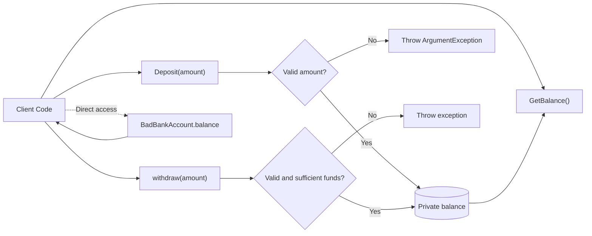
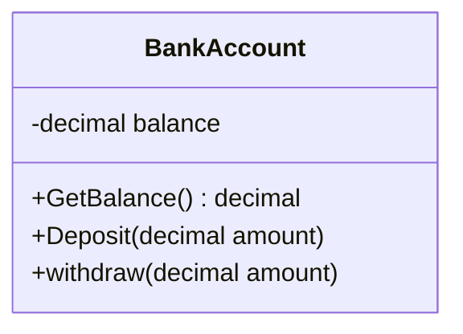

# Encapsulation

Encapsulation is one of the main principles of Object-Oriented Programming (OOP).

It means:

1. Keeping important data inside a class.
2. Allowing other classes to access that data only through controlled methods.
3. Preventing invalid changes to the data.

## Simple example: Bank account

Think of a bank account:

- The balance must not be changed directly.
- A customer must use deposit and withdrawal operations.
- The bank checks whether each operation is valid.

This same idea is shown in the following files:

- `BankAccount.cs` demonstrates encapsulation.
- `BadBankAccount.cs` demonstrates a lack of encapsulation.

## Encapsulated bank account

The balance is private in `BankAccount.cs`:

```csharp
private decimal balance;
```

The word `private` means that code outside the `BankAccount` class cannot access the field directly.

### Available operations

| Method | Purpose |
|---|---|
| `GetBalance()` | Returns the current balance |
| `Deposit(decimal amount)` | Adds valid money to the balance |
| `withdraw(decimal amount)` | Removes valid money from the balance |

### Example rules

- A deposit must be greater than zero.
- A withdrawal must be greater than zero.
- A withdrawal cannot exceed the available balance.

These rules keep the bank account in a valid state.

## Without encapsulation

In `BadBankAccount.cs`, the balance is public:

```csharp
public decimal balance;
```

Therefore, other code can change it directly:

```csharp
BadBankAccount account = new BadBankAccount();
account.balance = -100;
```

This bypasses the deposit and withdrawal rules and may create an invalid account.

## Why encapsulation is useful

- **Protects data:** Internal values cannot be changed unexpectedly.
- **Enforces rules:** Validation is placed inside the class.
- **Reduces mistakes:** Other classes use simple, predefined operations.
- **Improves maintenance:** Validation rules can be changed in one place.

## Encapsulation flow



## Important terms

| Term | Meaning |
|---|---|
| Private field | Data that other classes cannot access directly |
| Public method | An operation that other classes can call |
| Validation | Checking whether a value or operation is allowed |
| Object state | The current values stored in an object's fields |

## `is-a` and `has-a` relationships

Encapsulation can protect the parts involved in both kinds of relationships:

| Relationship | Question | Example |
|---|---|---|
| `is-a` | Is the object a specialized type of another object? | A `SavingsAccount` is a type of `BankAccount`. |
| `has-a` | Does the object own or contain another value or object? | A `BankAccount` has a private balance. |

Encapsulation changes direct access to the object's parts. Even when a class contains another object or value, code outside the class should normally use public operations rather than directly modifying the contained state.

## UML: Unified Modeling Language

UML can model the fields and operations that protect an object's state.



The leading `-` shows that `balance` is private. The leading `+` shows that account operations are public and provide controlled access to the internal state.

## Summary

Encapsulation hides an object's internal data and controls how it is accessed. In this example, `balance` remains private, and other code uses methods that validate each change. This protects the object's state and keeps the program reliable.

---

| ← [Abstraction](../Abstraction/Abstraction.md) | [Book contents](../../README.md) | [Inheritance](../Inheritance/Inheritance.md) → |
|---|---|---|
