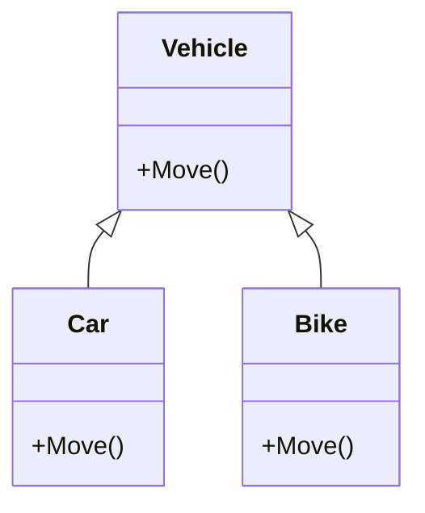
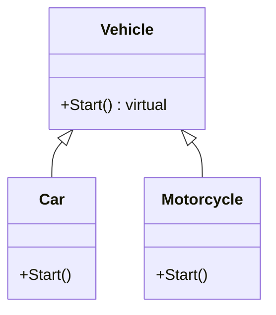

# Polymorphism

Polymorphism is one of the main principles of Object-Oriented Programming (OOP).

The word means "many forms." It allows different classes to provide their own version of the same method while sharing a common base type.

## Simple example: Moving vehicles

Suppose several vehicles share a method named `Move()`.

- A car moves by driving.
- A bike moves by pedaling.
- A truck moves by driving with a heavy load.

Each vehicle uses the same method name, but performs the operation differently.

## Polymorphism diagram



## Base class

```csharp
public class Vehicle
{
    public virtual void Move()
    {
        Console.WriteLine("The vehicle is moving.");
    }
}
```

The `virtual` keyword allows a derived class to replace the base implementation.

## Derived classes

```csharp
public class Car : Vehicle
{
    public override void Move()
    {
        Console.WriteLine("The car is driving.");
    }
}

public class Bike : Vehicle
{
    public override void Move()
    {
        Console.WriteLine("The bike is pedaling.");
    }
}
```

The `override` keyword provides a new implementation for each class.

## Calling polymorphic methods

```csharp
Vehicle car = new Car();
Vehicle bike = new Bike();

car.Move();
bike.Move();
```

Output:

```text
The car is driving.
The bike is pedaling.
```

Although both variables have the `Vehicle` type, the program calls the method defined for the actual object type.

## Why polymorphism is useful

- **Uses a common interface:** Different objects can be handled using a shared base type.
- **Reduces conditional logic:** The program does not need separate checks for every class.
- **Supports extension:** New derived classes can add behavior without changing existing calling code.
- **Improves readability:** The same operation can be called consistently.

## Types of polymorphism

### Compile-time polymorphism

Method overloading allows multiple methods with the same name but different parameters.

```csharp
public void Print(string value) { }
public void Print(int value) { }
```

### Runtime polymorphism

Overridden methods are selected while the program is running.

```csharp
public virtual void Move() { }
public override void Move() { }
```

## `is-a` and `has-a` relationships

Polymorphism is usually shown through `is-a` inheritance relationships because subclasses replace or extend one shared contract.

| Relationship | Example | Polymorphic behavior |
|---|---|---|
| `is-a` | A `Car` is a `Vehicle`. | A `Car` can override `Vehicle.Start()`. |
| `has-a` | A `Car` has a navigation system. | The car delegates behavior to a component. |

Calling code can store `Car` and `Motorcycle` objects as `Vehicle` references and invoke polymorphic operations. For capabilities supplied by separate components, composition with a `has-a` relationship may be more appropriate.

## UML: Unified Modeling Language

UML class diagrams can show polymorphism through inheritance and overridden operations.



The shared `Start()` operation is declared by `Vehicle` and implemented by each derived class. Calling code can invoke `Start()` through the common `Vehicle` type.

## Summary

Polymorphism lets related classes provide different implementations of the same operation. Derived classes can override base methods, and calling code can work with objects through their shared base type.

---

| ← [Inheritance](../Inheritance/Inheritance.md) | [Book contents](../../README.md) | [Composition](../Composition/Composition.md) → |
|---|---|---|
