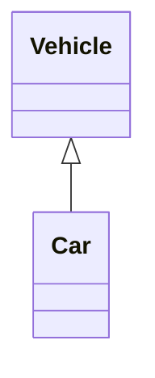
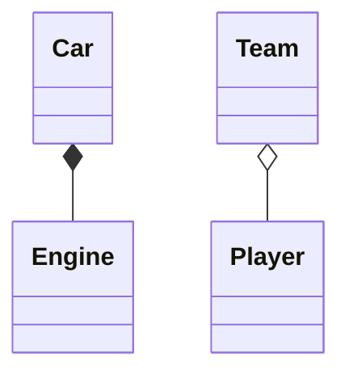
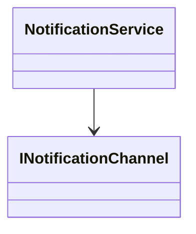

# C# Design Patterns and OOP Guide

> An e-book style guide to the concepts implemented in this repository.

## About This Book

This repository demonstrates object-oriented programming principles through small, executable C# examples. Read the chapters in order for a structured introduction, or use the reference sections for targeted study.

**Audience:** Beginner to intermediate C# developers  
**Language:** C# / .NET 10  
**Project:** `DesignPattern`

> **Ready to run the examples?** See the [Setup and Run Guide](SETUP.md) for prerequisites, .NET SDK installation, and step-by-step commands.

---

## Reader's Roadmap

Read the chapters in order for a guided introduction. The OOP and SOLID lesson pages include previous/next links and a return link to this contents page.

### Part I - Foundations

1. [Getting Started](#1-getting-started)
2. [Project Structure](#2-project-structure)
3. [Object-Oriented Relationships](#3-object-oriented-relationships)
4. [UML Reading Guide](#4-uml-reading-guide)

**Supplement:** [UML Diagram Readability Guide](UML-Readability-Guide.md)

### Part II - OOP Principles

5. [Abstraction](OopPrinciples/Abstraction/Abstraction.md)
6. [Encapsulation](OopPrinciples/Encapsulation/Encapsulation.md)
7. [Inheritance](OopPrinciples/Inheritance/Inheritance.md)
8. [Polymorphism](OopPrinciples/Polymorphism/Polymorphism.md)
9. [Composition](OopPrinciples/Composition/Composition.md)

### Part III - Design Decisions

10. [Inheritance versus Composition](#10-inheritance-versus-composition)
11. [Fragile Base Class Problem](#11-fragile-base-class-problem)

### Part IV - SOLID Principles

12. [Single Responsibility Principle (SRP)](SOLID/S/SingleResponsibilityPrinciple.md)
13. [Open-Closed Principle (OCP)](SOLID/O/OpenClosedPrinciple.md)
14. [Liskov Substitution Principle (LSP)](SOLID/L/LiskovSubstitutionPrinciple.md)
15. [Interface Segregation Principle (ISP)](SOLID/I/InterfaceSegregationPrinciple.md)
16. [Dependency Inversion Principle (DIP)](SOLID/D/DependencyInversionPrinciple.md)

### Part V - Practice and Reference

17. [Examples and Exercises](#17-examples-and-exercises)
18. [Running the Repository](#18-running-the-repository)
19. [Concept Reference](#19-concept-reference)

---

## 1. Getting Started

Object-oriented programming organizes a program into objects. A class defines a type of object, while an instance stores a particular state and can perform operations.

```csharp
BankAccount account = new BankAccount(100);
account.Deposit(50);
```

Key ideas include:

- A **class** is a reusable blueprint.
- An **object** is an instance of a class.
- A **field** stores object data.
- A **property** provides controlled access to data.
- A **method** performs an operation.
- A **namespace** organizes related types.

**Continue reading:** [Project Structure](#2-project-structure)

## 2. Project Structure

```text
DesignPattern/
├── Program.cs
├── src/
│   ├── OopPrinciples/
│   │   └── ... C# source files ...
│   └── SOLID/
│       └── ... C# examples ...
└── docs/
    ├── README.md
    ├── SETUP.md
    ├── UML-Readability-Guide.md
    ├── OopPrinciples/
    │   ├── Abstraction/
    │   ├── Composition/
    │   ├── Encapsulation/
    │   ├── Inheritance/
    │   └── Polymorphism/
    └── SOLID/
        ├── D/
        ├── I/
        ├── L/
        ├── O/
        └── S/
```

The `src` folders contain C# code. All Markdown learning material is under `docs`, grouped by OOP principles and SOLID principle.

**Continue reading:** [Object-Oriented Relationships](#3-object-oriented-relationships)

## 3. Object-Oriented Relationships

### `is-a`

Use inheritance when one class is a specialized type of another class.

- A `Car` is a `Vehicle`.
- A `Bike` is a `Vehicle`.
- A `SavingsAccount` is a `BankAccount`.

In UML, inheritance uses a hollow triangle arrow:



### `has-a`

Use composition or aggregation when an object contains or collaborates with another object.

- A `Car` has an `Engine`.
- A `Team` has `Player` objects.
- A `NotificationService` has an `INotificationChannel`.

In UML, composition uses a filled diamond and aggregation uses an unfilled diamond:



### Dependency

An object has a dependency when it uses a service or abstraction to perform work, even if it does not own that object.



**Continue reading:** [UML Reading Guide](#4-uml-reading-guide)

## 4. UML Reading Guide

| UML symbol | Meaning |
|---|---|
| `+` | Public member |
| `-` | Private member |
| `#` | Protected member |
| Hollow triangle | Inheritance or realization |
| Filled diamond | Composition |
| Unfilled diamond | Aggregation |
| Arrow | Association or dependency |

**Continue reading:** [Abstraction](OopPrinciples/Abstraction/Abstraction.md)

---

## 5. Abstraction

**Core idea:** Hide unnecessary implementation detail and expose meaningful operations.

**Relationship focus:** A caller may have an abstraction service dependency, while the service internally organizes complex work.

**Repository lesson:** [Abstraction.md](OopPrinciples/Abstraction/Abstraction.md)

**Example:** [EmailService.cs](../src/OopPrinciples/Abstraction/EmailService.cs)

```csharp
emailService.SendEmail();
```

The caller does not need to manually connect to the server, authenticate, send, and disconnect.

## 6. Encapsulation

**Core idea:** Protect object state and control access through validated operations.

**Relationship focus:** A `BankAccount` has a private balance that should not be changed directly.

**Repository lesson:** [Encapsulation.md](OopPrinciples/Encapsulation/Encapsulation.md)

**Examples:** [BankAccount.cs](../src/OopPrinciples/Encapsulation/BankAccount.cs), [BadBankAccount.cs](../src/OopPrinciples/Encapsulation/BadBankAccount.cs)

```csharp
BankAccount account = new BankAccount(100);
account.Deposit(50);
decimal balance = account.GetBalance();
```

## 7. Inheritance

**Core idea:** Reuse and specialize behavior through an `is-a` relationship.

**Repository lesson:** [Inheritance.md](OopPrinciples/Inheritance/Inheritance.md)

**Examples:** [Vehicle.cs](../src/OopPrinciples/Inheritance/Vehicle.cs), [Car.cs](../src/OopPrinciples/Inheritance/Car.cs), [Bike.cs](../src/OopPrinciples/Inheritance/Bike.cs)

```csharp
public class Car : Vehicle
{
    public int NumberOfDoors { get; set; }
}
```

Inheritance is appropriate when derived classes are genuine subtypes of the base class and share a stable contract.

## 8. Polymorphism

**Core idea:** Different objects implement a shared operation in different ways.

**Relationship focus:** A `Car` and `Motorcycle` are both vehicles, so they are polymorphic through the `Vehicle` contract.

**Repository lesson:** [Polymorphism.md](OopPrinciples/Polymorphism/Polymorphism.md)

```csharp
List<Vehicle> vehicles =
[
    new Car(),
    new Motorcycle()
];

foreach (Vehicle vehicle in vehicles)
{
    vehicle.Start();
}
```

## 9. Composition

**Core idea:** Build objects from smaller objects, behavior components, or services.

**Relationship focus:** A `Car` has an `Engine`; composition models a `has-a` relationship.

**Repository lesson:** [Composition.md](OopPrinciples/Composition/Composition.md)

```csharp
public class Car
{
    private readonly Engine engine;

    public Car(Engine engine)
    {
        this.engine = engine;
    }

    public void Start()
    {
        engine.Start();
    }
}
```

## 10. Inheritance versus Composition

| Decision | Prefer inheritance | Prefer composition |
|---|---|---|
| Relationship | Stable and genuine `is-a` | Flexible `has-a` or collaboration |
| Behavior | Shared subtype behavior | Replaceable or configurable components |
| Coupling | Tighter | Looser |
| Change risk | Higher in deep hierarchies | Lower when contracts are small |
| Example | `Car` is a `Vehicle` | `Car` has an `Engine` |

**Continue reading:** [Fragile Base Class Problem](#11-fragile-base-class-problem)

## 11. Fragile Base Class Problem

Inheritance can tightly couple derived classes to base-class implementation. A base-class change may unintentionally change derived behavior, making large hierarchies difficult to maintain.

Reduce the risk by:

- Using composition for replaceable behavior.
- Depending on interfaces rather than concrete implementations.
- Keeping inheritance hierarchies small and stable.
- Applying dependency inversion.
- Designing extensions through small contracts.

**Continue reading:** [SOLID Principles](#solid-principles-at-a-glance)

## SOLID Principles at a Glance

SOLID is a set of five principles for designing cohesive, extensible, and maintainable object-oriented software. Each guide explains the definition, demonstrates the principle, and connects it to available source examples:

- **SRP:** Keep each class focused on one responsibility. The user-registration examples are in [the SRP guide](SOLID/S/SingleResponsibilityPrinciple.md).
- **OCP:** Extend behavior through abstractions instead of adding branches to stable code. The shape examples are in [the OCP guide](SOLID/O/OpenClosedPrinciple.md).
- **LSP:** Ensure subtypes honor the behavior promised by their base type. The shape hierarchy is discussed in [the LSP guide](SOLID/L/LiskovSubstitutionPrinciple.md).
- **ISP:** Keep interfaces focused on the capabilities clients use. See [the ISP guide](SOLID/I/InterfaceSegregationPrinciple.md).
- **DIP:** Make high-level policy depend on abstractions rather than concrete details. The order-notification example is discussed in [the DIP guide](SOLID/D/DependencyInversionPrinciple.md).

## 17. Examples and Exercises

### Exercise A: Relationship classifier

For each pair, decide whether the relationship is `is-a`, `has-a`, or a dependency:

1. `Car` and `Vehicle`
2. `Car` and `Engine`
3. `NotificationService` and `EmailChannel`
4. `SavingsAccount` and `BankAccount`
5. `House` and `Room`

### Exercise B: Encapsulate a library

Create a `Library` class with a private list of books. Expose methods to borrow and return a book. Add validation so a missing book cannot be borrowed.

### Exercise C: Change inheritance to composition

Create a notification hierarchy and then replace it with an `INotificationChannel` interface and a notification service that receives the channel through its constructor.

### Exercise D: Identify the fragile class

Choose a base class that has several derived classes. Explain which inherited methods could change unexpectedly and how composition could isolate the behavior.

## 18. Running the Repository

The project requires the **.NET 10 SDK** and does not rely on third-party libraries. See the [Setup and Run Guide](SETUP.md) for installation, IDE setup, and troubleshooting.

Quick start from the repository root in PowerShell:

```powershell
dotnet clean .\DesignPattern\DesignPattern.csproj
dotnet build .\DesignPattern\DesignPattern.csproj
dotnet run --project .\DesignPattern\DesignPattern.csproj -- composition
```

Run any example by replacing `composition` with one of:

- `encapsulation`
- `abstraction`
- `inheritance`
- `polymorphism`
- `coupling`
- `composition`

## 19. Concept Reference

| Concept | Meaning |
|---|---|
| Abstraction | Exposes meaningful operations while hiding implementation detail |
| Encapsulation | Protects state and controls access |
| Inheritance | Creates subtype relationships through a base class |
| Polymorphism | Uses one operation contract for objects with different implementations |
| Composition | Builds objects from contained components or services |
| Aggregation | Contains objects that may exist independently |
| Coupling | The degree to which classes depend on one another |
| Interface | A contract implemented by classes |
| Dependency inversion | High-level code depends on abstractions rather than concrete details |
| Fragile base class | Base-class inheritance that makes derived classes unexpectedly fragile |

## Suggested Reading Order

1. [Abstraction](OopPrinciples/Abstraction/Abstraction.md)
2. [Encapsulation](OopPrinciples/Encapsulation/Encapsulation.md)
3. [Inheritance](OopPrinciples/Inheritance/Inheritance.md)
4. [Polymorphism](OopPrinciples/Polymorphism/Polymorphism.md)
5. [Composition](OopPrinciples/Composition/Composition.md)
6. [SRP](SOLID/S/SingleResponsibilityPrinciple.md)
7. [OCP](SOLID/O/OpenClosedPrinciple.md)
8. [LSP](SOLID/L/LiskovSubstitutionPrinciple.md)
9. [ISP](SOLID/I/InterfaceSegregationPrinciple.md)
10. [DIP](SOLID/D/DependencyInversionPrinciple.md)

---

*End of guide.*
