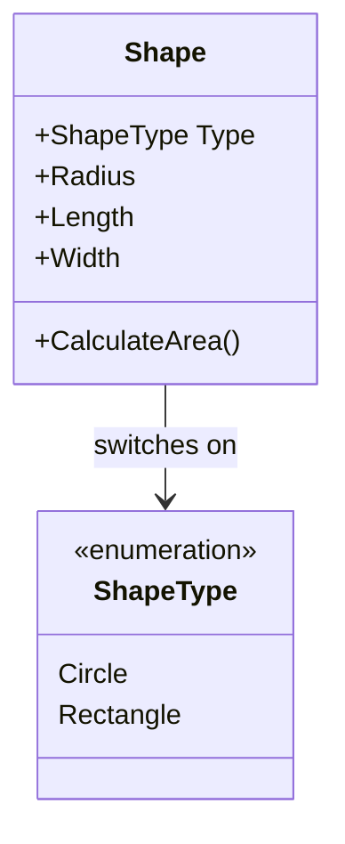
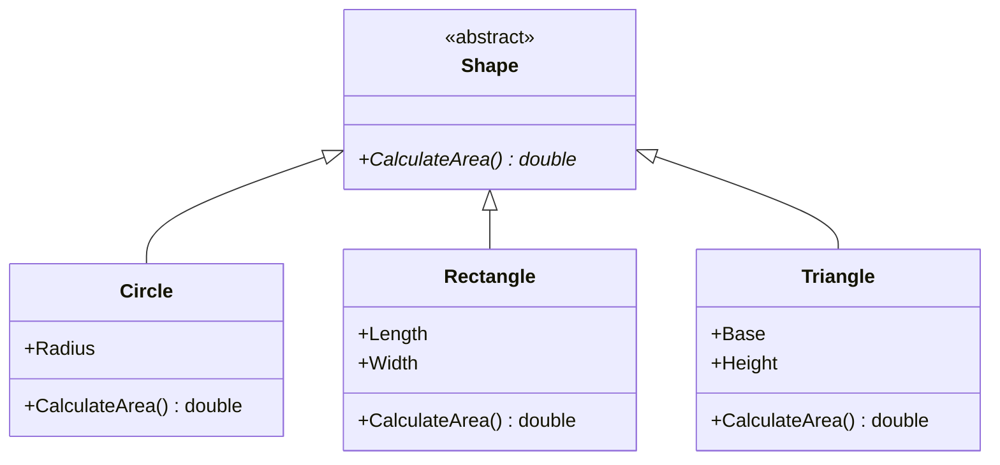

# Open-Closed Principle (OCP)

> Software entities (classes, modules, functions, etc.) should be open for extension but closed for modification.

New behavior should usually be added by introducing a new implementation behind an existing contract, rather than repeatedly editing stable code.

## OCP in this repository

The two shape examples contrast editing a central conditional with extending a shared abstraction:

- [`BadExample/Shape.cs`](../../../src/SOLID/O/BadExample/Shape.cs) switches on [`ShapeType`](../../../src/SOLID/O/BadExample/ShapeType.cs) to calculate each supported shape's area. Adding a shape requires changing this calculation and the enum.
- [`BetterExample/Shape.cs`](../../../src/SOLID/O/BetterExample/Shape.cs) defines the common `CalculateArea()` contract.
- [`BetterExample/Circle.cs`](../../../src/SOLID/O/BetterExample/Circle.cs), [`BetterExample/Rectangle.cs`](../../../src/SOLID/O/BetterExample/Rectangle.cs), and [`BetterExample/Triangle.cs`](../../../src/SOLID/O/BetterExample/Triangle.cs) provide their own implementations.

To add another shape, create another `Shape` subclass and implement `CalculateArea()`; the existing shape classes and area calculation loop do not need a new shape-specific branch.

### BadExample: central type switch



`Shape.CalculateArea()` branches on `ShapeType`. Supporting another shape means modifying the enum and the calculation method, so the existing class is not closed to modification.

### BetterExample: extend the shape hierarchy



The hollow triangle arrows indicate inheritance: each concrete shape is a `Shape` and supplies its own area calculation. Adding a new shape extends the hierarchy instead of adding another shape-specific branch to a central switch.

## Example: Payment processing

### Before: adding a payment type changes existing logic

```csharp
public class PaymentProcessor
{
    public void Process(string paymentType, decimal amount)
    {
        if (paymentType == "card")
        {
            Console.WriteLine($"Charging card: {amount}");
        }
        else if (paymentType == "cash")
        {
            Console.WriteLine($"Accepting cash: {amount}");
        }
    }
}
```

Every new payment type requires another branch and a modification to `PaymentProcessor`.

### After: extend through an abstraction

```csharp
public interface IPaymentMethod
{
    void Pay(decimal amount);
}

public class CardPayment : IPaymentMethod
{
    public void Pay(decimal amount) =>
        Console.WriteLine($"Charging card: {amount}");
}

public class CashPayment : IPaymentMethod
{
    public void Pay(decimal amount) =>
        Console.WriteLine($"Accepting cash: {amount}");
}

public class PaymentProcessor
{
    public void Process(IPaymentMethod paymentMethod, decimal amount)
    {
        paymentMethod.Pay(amount);
    }
}
```

A new payment method can implement `IPaymentMethod` without changing the processor:

```csharp
public class GiftCardPayment : IPaymentMethod
{
    public void Pay(decimal amount) =>
        Console.WriteLine($"Using gift card: {amount}");
}
```

## Relationship to other principles

`PaymentProcessor` **has a dependency on** the `IPaymentMethod` abstraction. Implementations such as `CardPayment` and `CashPayment` fulfill the same contract; they do not need to be subclasses of the processor.

## When to apply OCP

- New variants are expected to be added over time.
- Stable code has growing conditional logic for each variant.
- Behavior can be isolated behind an interface, strategy, or other extension point.

OCP does not mean that code must never change. Add extension points where variation is likely; avoid speculative abstractions for behavior that is not expected to vary.

---

| ← [SRP](../S/SingleResponsibilityPrinciple.md) | [Book contents](../../README.md) | [LSP](../L/LiskovSubstitutionPrinciple.md) → |
|---|---|---|
