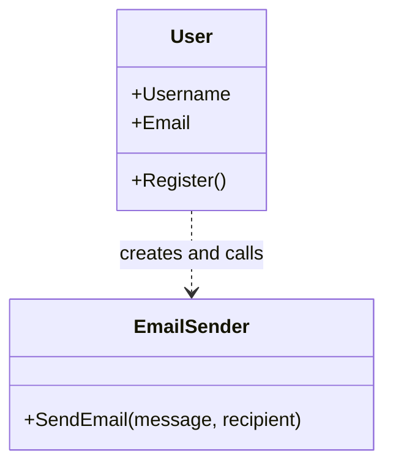
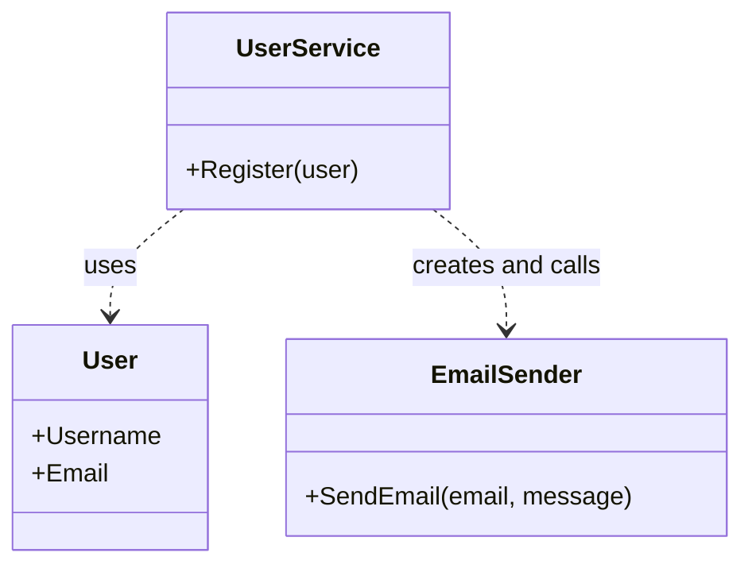

# Single Responsibility Principle (SRP)

> A class should have only one reason to change, meaning that it should have only one responsibility or purpose.

“One responsibility” does not mean that a class can have only one method. Its methods should work together to serve one cohesive purpose.

## SRP in this repository

The `BadExample` and `BetterExample` folders show how separating responsibilities changes the user-registration design:

- [`BadExample/User.cs`](../../../src/SOLID/S/BadExample/User.cs) holds user data, performs registration, creates an `EmailSender`, and sends the welcome email. A change to user data or email delivery can force this class to change.
- [`BetterExample/User.cs`](../../../src/SOLID/S/BetterExample/User.cs) only represents user data.
- [`BetterExample/UserService.cs`](../../../src/SOLID/S/BetterExample/UserService.cs) handles the registration workflow.
- [`BetterExample/EmailSender.cs`](../../../src/SOLID/S/BetterExample/EmailSender.cs) handles sending email.

The improved version gives the user model and email sender focused responsibilities. `UserService` coordinates registration; it still constructs `EmailSender` directly, which is a separate dependency-inversion concern covered by DIP.

### BadExample: responsibilities combined



`User` stores user data, runs registration, and initiates email delivery. A change to any of those responsibilities can require modifying `User`.

### BetterExample: responsibilities separated



`User` is now a data model, `UserService` coordinates registration, and `EmailSender` sends email. The dashed arrows show dependencies, not inheritance. The direct dependency from `UserService` to `EmailSender` remains, so SRP is improved without yet applying DIP.

## Example: Separate report responsibilities

A report can be created, formatted, and saved. These are separate responsibilities and may change for different reasons.

### Before: one class handles everything

```csharp
public class Report
{
    public string Create()
    {
        return "Monthly sales report";
    }

    public string FormatAsHtml(string report)
    {
        return $"<h1>{report}</h1>";
    }

    public void SaveToFile(string report, string path)
    {
        File.WriteAllText(path, report);
    }
}
```

Changing the report content, its HTML format, or its storage behavior all requires changing `Report`.

### After: one cohesive responsibility per class

```csharp
public class ReportGenerator
{
    public string Create()
    {
        return "Monthly sales report";
    }
}

public class HtmlReportFormatter
{
    public string Format(string report)
    {
        return $"<h1>{report}</h1>";
    }
}

public class ReportFileWriter
{
    public void Save(string report, string path)
    {
        File.WriteAllText(path, report);
    }
}
```

Each class now has a focused reason to change. An application can coordinate them:

```csharp
var generator = new ReportGenerator();
var formatter = new HtmlReportFormatter();
var writer = new ReportFileWriter();

string report = formatter.Format(generator.Create());
writer.Save(report, "sales.html");
```

## Relationship to other principles

SRP helps keep components small and cohesive. It does not dictate whether classes have `is-a` or `has-a` relationships. For example, an application may **have** a report generator and a formatter and coordinate their work.

## When to apply SRP

- A class has unrelated methods that change for different business or technical reasons.
- Tests for one behavior require setting up unrelated behavior.
- A class name needs “and” to describe its responsibilities.

Avoid splitting a class into many tiny types when their behavior always changes together. Aim for cohesion, not a particular number of methods.

---

| ← [Composition](../../OopPrinciples/Composition/Composition.md) | [Book contents](../../README.md) | [OCP](../O/OpenClosedPrinciple.md) → |
|---|---|---|
