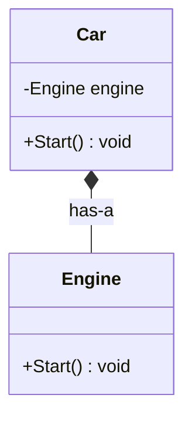
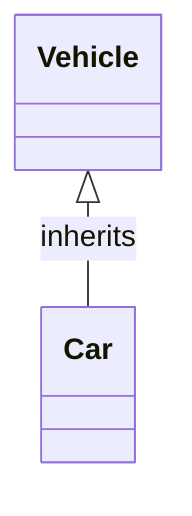
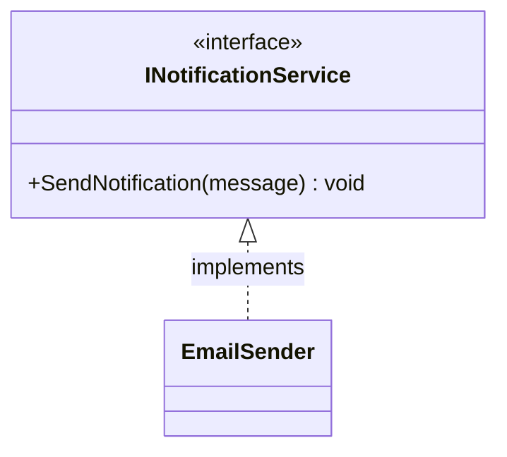
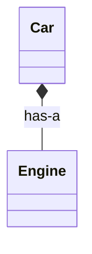
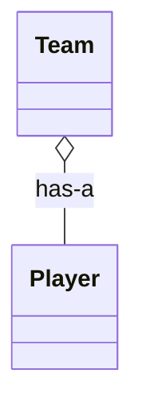
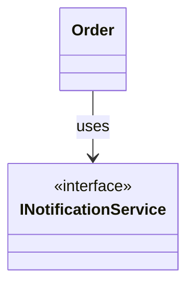
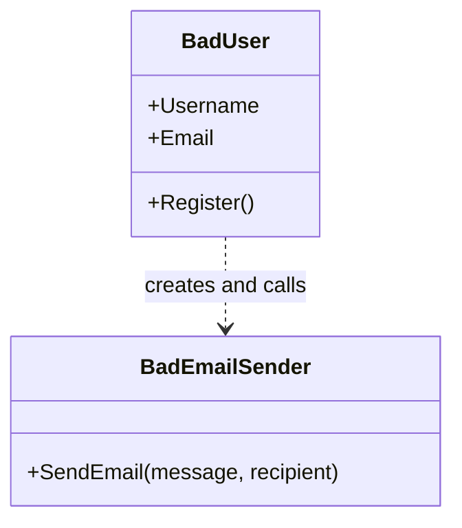
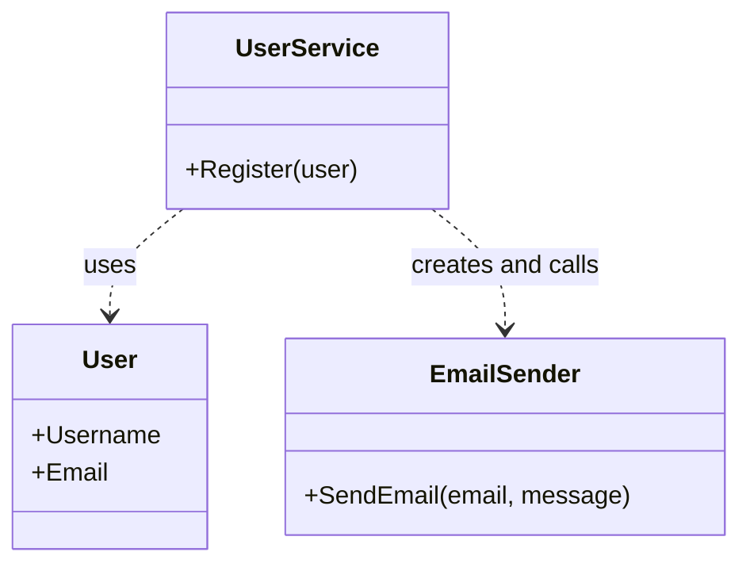
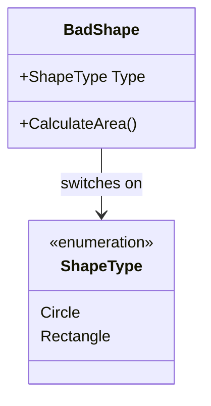
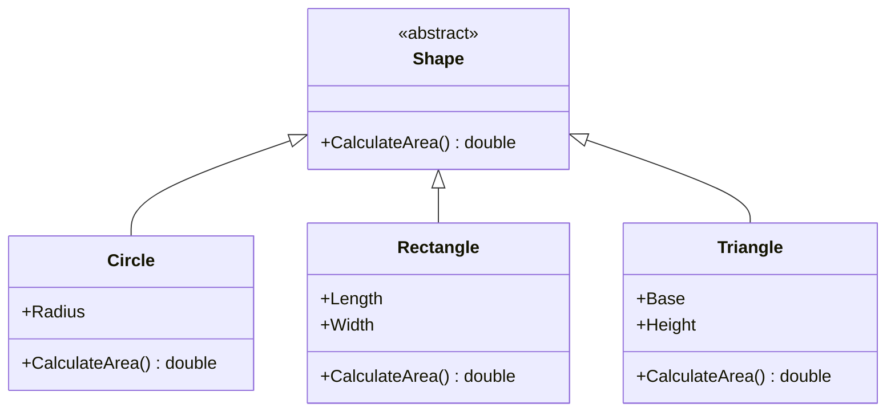

# UML Diagram Readability Guide

This guide explains how to read and create the UML-style class diagrams used in this repository. The diagrams are written in Mermaid inside Markdown code fences, so the source remains text and can be version-controlled with the lessons.

## What a class diagram shows

A UML class diagram describes the static structure of a program:

- **Classes and interfaces** — the types in the design.
- **Attributes** — data held by a type.
- **Operations** — methods the type exposes.
- **Relationships** — inheritance, implementation, composition, and dependencies.

It does not show the order in which a program executes. Use a flowchart or sequence diagram when you need to explain steps over time.

## Class box illustration

Read the `Car` box from top to bottom:

1. `Car` is the class name.
2. `-Engine engine` is a private field: `-` means private, followed by its type and name.
3. `+Start() void` is a public method: `+` means public; the parentheses show it is an operation.
4. `Car *-- Engine` means `Car` is composed of an `Engine`.

The diagram is a design illustration. Its attributes and methods should reflect the code being described; the example here shows the common `Car has an Engine` relationship.

## Visibility symbols

| Symbol | UML visibility | Typical C# member |
|---|---|---|
| `+` | Public | `public` |
| `-` | Private | `private` |
| `#` | Protected | `protected` |
| `~` | Package/internal | `internal` |

Use visibility markers when they help explain encapsulation. A class diagram does not need to list every field and method in the implementation.

## Relationship arrows

The arrowhead and line style explain how types are related. Read the label as a sentence when one is present.

### Inheritance: `is-a`

The hollow triangle points to the base class. This means `Car` **is a** `Vehicle`. In Mermaid, `Vehicle <|-- Car` reads from child to parent: `Car` derives from `Vehicle`.

### Interface implementation

The hollow triangle with a dashed line indicates that `EmailSender` implements the `INotificationService` contract.

### Composition: owned `has-a`

The filled diamond is on the owning or whole side. Composition indicates a strong whole-part relationship: the whole owns the part's lifecycle in the model.

### Aggregation: independent `has-a`

The unfilled diamond indicates aggregation. The `Player` can exist independently of a particular `Team`.

### Association and dependency

A solid association arrow represents a navigable relationship. A dashed dependency arrow (`..>`) represents a class that uses another type, for example as a method parameter or temporary local.

In the repository's `Order` example, the order holds an `INotificationService` field supplied by its constructor. This is a persistent association/dependency, not composition ownership: the `Order` does not create the sender.

## Reading the SOLID diagrams

### SRP: one combined responsibility versus separated responsibilities

In the SRP `BadExample`, `User` owns user data and performs registration and email coordination. The arrow shows its dependency on the sender; the multiple responsibilities are explained by the methods and text, not by the arrow itself.

In the `BetterExample`, each class has a more focused purpose. The arrows are dependencies. `UserService` still constructs `EmailSender` directly, so this example demonstrates SRP separation, not full dependency inversion.

### OCP: central switch versus extending a contract

The `BadExample` puts shape-specific behavior in one `Shape.CalculateArea()` switch. A new shape requires modifying that class and the enum.

The hollow triangles show that concrete shapes inherit the `Shape` contract. Each class supplies its own area calculation. Adding a shape means extending the hierarchy rather than adding another branch to the existing calculation.

## How to read Mermaid diagrams in Markdown

1. **Find the class names first.** Each `class` declaration creates a box.
2. **Read each box top to bottom.** The top is the type name; the body lists attributes and operations.
3. **Check the arrowhead.** A hollow triangle means inheritance or implementation; a diamond means a whole-part relationship.
4. **Check the line.** Solid and dashed lines distinguish associations from dependencies or implementation.
5. **Read relationship labels.** Labels such as `has-a`, `uses`, or `implements` clarify intent.
6. **Follow direction carefully.** In Mermaid, `Base <|-- Derived` means `Derived` inherits from `Base`; the triangle points to `Base`.
7. **Compare with the C# source.** Diagrams summarize code and should not be treated as a substitute for checking the class implementation.

## Writing readable class diagrams

- Keep each diagram focused on one idea; split large designs into several diagrams.
- Include only members needed to explain that idea.
- Use concise labels and consistent names that match the C# code.
- Prefer explicit relationship labels when the meaning may not be obvious.
- Place the inheritance triangle at the base-class end and the composition diamond at the whole end.
- Explain what the viewer should notice immediately after the diagram.
- Avoid claiming ownership for a normal dependency or association.
- Check that each diagram matches the current source whenever classes change.

## Viewing the diagrams

The diagrams are Mermaid source blocks in `.md` files. Open a Markdown preview in an editor that supports Mermaid rendering, or view the Markdown on a hosting service that renders Mermaid. If the preview displays a code block instead of a diagram, the viewer may not support Mermaid; the text notation is still readable and remains in the source.

## Related reading

- [C# Design Patterns and OOP Guide](README.md)
- [Composition guide](OopPrinciples/Composition/Composition.md)
- [Inheritance guide](OopPrinciples/Inheritance/Inheritance.md)
- [SRP guide](SOLID/S/SingleResponsibilityPrinciple.md)
- [OCP guide](SOLID/O/OpenClosedPrinciple.md)
