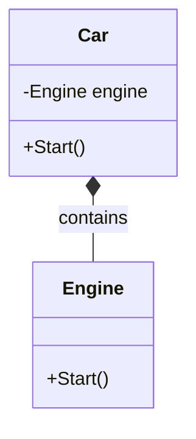
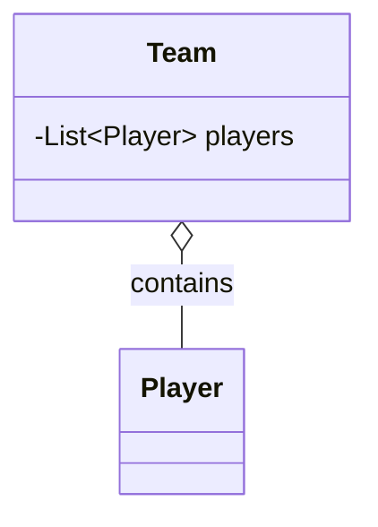

# Composition

Composition is an object-oriented design principle where a class is built from other objects instead of inheriting behavior from a parent class.

It means that an object **has** other objects:

- A car **has** an engine.
- A computer **has** a keyboard.
- An order **has** products.

Composition allows classes to reuse functionality by containing instances of other classes.

## Simple example: Car and engine

```csharp
public class Engine
{
    public void Start()
    {
        Console.WriteLine("Engine started.");
    }
}

public class Car
{
    private readonly Engine engine = new Engine();

    public void Start()
    {
        engine.Start();
        Console.WriteLine("Car started.");
    }
}
```

The `Car` class contains an `Engine`. It delegates the starting operation to the engine and adds its own behavior.

## When to use composition

Composition is useful when:

- Flexibility is needed when constructing objects by assembling smaller, reusable components.
- Classes do not have a clear `is-a` relationship.
- Behavior is better expressed through a `has-a` relationship.
- A hierarchy would make changes risky because the base class is tightly coupled to every derived class.
- Behavior can vary independently and should be configurable at runtime.

## Composition example: Notification service

An application can send notifications through different channels. Email and SMS are capabilities, not subclasses of the application.

```csharp
public interface INotificationChannel
{
    void Send(string message);
}

public class EmailChannel : INotificationChannel
{
    public void Send(string message)
    {
        Console.WriteLine($"Email: {message}");
    }
}

public class SmsChannel : INotificationChannel
{
    public void Send(string message)
    {
        Console.WriteLine($"SMS: {message}");
    }
}

public class NotificationService
{
    private readonly INotificationChannel channel;

    public NotificationService(INotificationChannel channel)
    {
        this.channel = channel;
    }

    public void Notify(string message)
    {
        channel.Send(message);
    }
}
```

```csharp
NotificationService service = new NotificationService(new EmailChannel());
service.Notify("Your order has been shipped.");

service = new NotificationService(new SmsChannel());
service.Notify("Your order has been shipped.");
```

The notification service can use any channel without inheriting from it.

## When to use inheritance

Inheritance is useful when:

- Classes have a clear and stable `is-a` relationship.
- Derived classes can be treated uniformly through a common superclass.
- Reusable properties and behavior should be inherited from the base class.
- Polymorphism allows objects to be treated through their common interface.

## Inheritance example: Vehicles

```csharp
public class Vehicle
{
    public virtual void Start()
    {
        Console.WriteLine("Vehicle started.");
    }
}

public class Car : Vehicle
{
    public override void Start()
    {
        Console.WriteLine("Car started.");
    }
}

public class Motorcycle : Vehicle
{
    public override void Start()
    {
        Console.WriteLine("Motorcycle started.");
    }
}
```

A car and a motorcycle are vehicles, so inheritance represents their relationship clearly. Callers can store both types in a `Vehicle[]` or treat them through a common base class.

## Composition flow


## Composition relationships

| Relationship | Meaning |
|---|---|
| Aggregation | An object can contain another object that exists independently |
| Composition | An object owns and controls the lifecycle of another object |
| Delegation | An object forwards work to its contained object |

### Aggregation example

```csharp
public class Team
{
    private readonly List<Player> players;

    public Team(List<Player> players)
    {
        this.players = players;
    }
}
```

The players can exist independently of the team.

### Composition example

```csharp
public class House
{
    private readonly List<Room> rooms = new List<Room>();
}
```

A room belongs to a specific house and typically has no independent lifecycle outside it.

## Composition over inheritance

Composition is often preferred over inheritance when classes share behavior but do not represent an `is-a` relationship.

| Approach | Relationship | Example |
|---|---|---|
| Inheritance | `is-a` | A `Car` is a `Vehicle` |
| Composition | `has-a` | A `Car` has an `Engine` |

Inheritance creates a tight coupling between a parent and child class. Composition allows behavior to be assembled from smaller, replaceable components.

## Constructor injection

Dependencies can be supplied through the constructor:

```csharp
public class Car
{
    private readonly Engine engine;

    public Car(Engine engine)
    {
        this.engine = engine;
    }

    public void Start()
    {
        engine.Start();
    }
}
```

This makes the `Car` easier to test and allows different engine implementations to be provided.

## Fragile base class problem

Inheritance creates tight coupling between a base class and its derived classes. The fragile base class problem occurs when a change to the base class unexpectedly breaks derived classes or changes their behavior.

### Example

```csharp
public class Account
{
    public virtual void Withdraw(decimal amount)
    {
        Console.WriteLine($"Withdrew {amount}");
    }
}

public class SavingsAccount : Account
{
    public override void Withdraw(decimal amount)
    {
        if (amount <= 0)
        {
            throw new ArgumentException("Amount must be positive.");
        }

        base.Withdraw(amount);
    }
}
```

If the `Account.Withdraw` implementation changes later, every derived account must continue to work correctly. This becomes riskier with deeply nested inheritance hierarchies and existing subclasses.

The fragile base class problem is caused by:

- Tight coupling between parent and child classes.
- Changes that affect inherited behavior.
- Derived classes that depend on implementation details.
- Multiple levels of inheritance with complex interactions.

Inheritance is useful, but a base class should expose a stable contract and avoid making assumptions that force every derived class to depend on its internal implementation.

### Mitigation strategies

- Prefer composition and interfaces when behavior can be assembled from replaceable components.
- Use inheritance for stable, genuine `is-a` relationships.
- Use the open/closed principle so behavior can be extended without modifying existing classes.
- Depend on abstractions, especially interfaces, instead of concrete implementations.
- Apply dependency inversion by providing dependencies from the outside.
- Design small contracts and avoid exposing unnecessary implementation details.

### Composition example

Composition can isolate the fragile behavior by treating validation as a replaceable component:

```csharp
public interface IWithdrawalPolicy
{
    void Validate(decimal amount);
}

public class PositiveAmountPolicy : IWithdrawalPolicy
{
    public void Validate(decimal amount)
    {
        if (amount <= 0)
        {
            throw new ArgumentException("Amount must be positive.");
        }
    }
}

public class Account
{
    private readonly IWithdrawalPolicy withdrawalPolicy;

    public Account(IWithdrawalPolicy withdrawalPolicy)
    {
        this.withdrawalPolicy = withdrawalPolicy;
    }

    public void Withdraw(decimal amount)
    {
        withdrawalPolicy.Validate(amount);
        Console.WriteLine($"Withdrew {amount}");
    }
}
```

```csharp
Account account = new Account(new PositiveAmountPolicy());
account.Withdraw(100);
```

Changing or extending withdrawal validation does not require modifying an inheritance hierarchy. A different account can provide a different policy, while other code continues to depend on `IWithdrawalPolicy`.

## Why composition is useful

- **Flexible behavior:** Components can be replaced independently.
- **Loose coupling:** Classes depend on smaller abstractions rather than class hierarchies.
- **Better reuse:** Components can be shared by multiple classes.
- **Easier testing:** Dependencies can be substituted with test implementations.
- **Avoids inheritance limitations:** A class can combine several behaviors without multiple inheritance.

## Summary

Composition builds objects by combining smaller objects. It models a `has-a` relationship, delegates work to contained components, and often provides more flexibility than inheritance.

## UML: Unified Modeling Language

UML is a modeling language used to describe software systems, including the classes, interfaces, and relationships in an object-oriented program.

UML diagrams can represent composition through:

- A class containing another class.
- A diamond showing a whole-part relationship.
- An interface or dependency supplying behavior.

For example:



The filled diamond in a UML composition relationship indicates that `Car` owns the engine and controls its lifecycle.

Aggregation uses an unfilled diamond:



The relationship can be read as:

- `Car` is composed of an `Engine`.
- `Team` has one or more `Players`.
- `NotificationService` depends on an `INotificationChannel`.
