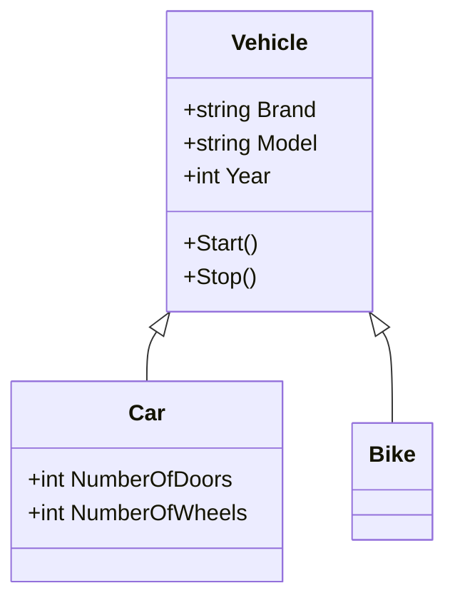
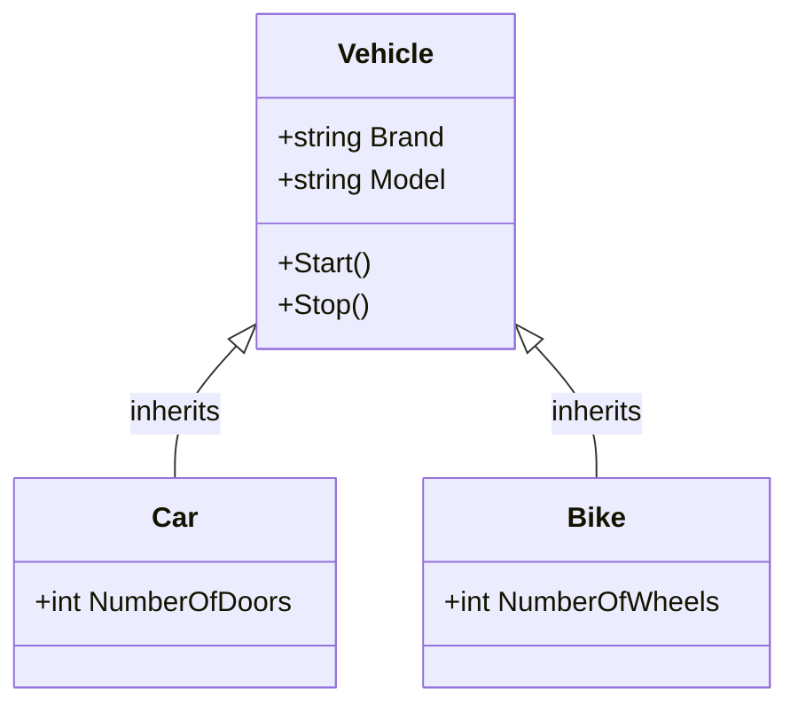

# Inheritance

Inheritance is one of the main principles of Object-Oriented Programming (OOP).

It allows a class to reuse properties and methods from another class. The new class becomes more specialized while keeping the common behavior from its parent class.

## Simple example: Vehicles

The example in this folder has three classes:

- `Vehicle` is the parent or base class.
- `Car` is a child or derived class.
- `Bike` is a child or derived class.

Cars and bikes share common vehicle properties and behavior, such as a brand, model, year, starting, and stopping.

## Class hierarchy



## Base class

The `Vehicle` class contains properties and methods common to all vehicles:

```csharp
public class Vehicle
{
    public string Brand { get; set; }
    public string Model { get; set; }
    public int Year { get; set; }

    public void Start()
    {
        Console.WriteLine("Vehicle is starting.");
    }

    public void Stop()
    {
        Console.WriteLine("Vehicle is stopping.");
    }
}
```

## Child classes

The `Car` class inherits from `Vehicle` by using a colon:

```csharp
public class Car : Vehicle
{
    public int NumberOfDoors { get; set; }
    public int NumberOfWheels { get; set; }
}
```

The `Bike` class also inherits from `Vehicle`:

```csharp
public class Bike : Vehicle
{
}
```

## Using inherited members

A `Car` object can use properties and methods defined in both its own class and the `Vehicle` class:

```csharp
Car car = new Car
{
    Brand = "Toyota",
    Model = "Corolla",
    Year = 2026,
    NumberOfDoors = 4
};

car.Start();
Console.WriteLine(car.Brand);
```

A `Bike` object can also use inherited members:

```csharp
Bike bike = new Bike
{
    Brand = "Giant",
    Model = "Escape",
    Year = 2026
};

bike.Start();
```

## Why inheritance is useful

- **Reuses code:** Common properties and methods are written once.
- **Models relationships:** It expresses that a car and a bike are types of vehicle.
- **Improves organization:** Shared behavior is stored in the base class.
- **Supports specialization:** Each child class can add unique members.

## Important terms

| Term | Meaning |
|---|---|
| Base class | The parent class that other classes inherit from |
| Derived class | The child class that inherits from another class |
| Inherited member | A property or method available because of inheritance |
| Parent class | Another name for a base class |
| Child class | Another name for a derived class |

## `is-a` and `has-a` relationships

Inheritance represents an `is-a` relationship:

- A `Car` is a `Vehicle`.
- A `Bike` is a `Vehicle`.
- A derived class can be treated as its base class.

Composition represents a `has-a` relationship:

- A `Car` has an engine.
- A `Bike` has wheels.
- Objects can contain or delegate work to other objects without inheriting from them.

| Relationship | UML design | Use when |
|---|---|---|
| `is-a` | Hollow inheritance arrow | The derived class is a subtype of the base class |
| `has-a` | Association or filled composition diamond | One class contains, owns, or uses another class |

## UML: Unified Modeling Language

UML uses a hollow triangle to represent inheritance. In a class diagram, the arrow points from the derived class to the base class.



This diagram shows that both `Car` and `Bike` inherit the shared members defined by `Vehicle`.

## Summary

Inheritance allows `Car` and `Bike` to reuse common vehicle data and behavior from `Vehicle`. The base class contains shared code, while each derived class can add its own specific features.
