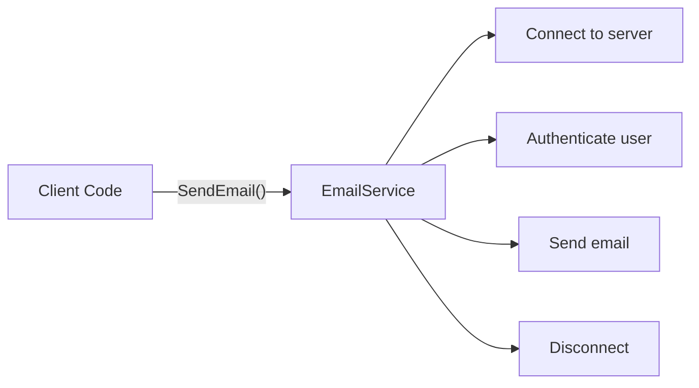

# Abstraction

Abstraction is one of the main principles of Object-Oriented Programming (OOP).

It means hiding complex implementation details and exposing only the operations needed by the user of a class.

## Simple example: Sending an email

Sending an email involves several internal steps:

1. Connect to an email server.
2. Authenticate the user.
3. Send the email.
4. Disconnect from the server.

A caller should not need to understand or control every internal step. It should only call an operation such as:

```csharp
emailService.SendEmail();
```

The `EmailService` class shown in this folder handles the complex steps internally.

## Abstraction flow



## Public interface

In `EmailService.cs`, `SendEmail()` is public:

```csharp
public void SendEmail()
```

This is the operation visible to the client. The client can send an email without knowing how the server connection or authentication works.

## Hidden implementation

The supporting methods are private:

```csharp
private void Connect()
private void Authenticate()
private void Disconnect()
```

The complexity is therefore hidden inside the class. Callers cannot invoke these methods directly.

## Without abstraction

Without abstraction, the caller might need to manage every step:

```csharp
emailService.Connect();
emailService.Authenticate();
emailService.SendEmail();
emailService.Disconnect();
```

This requires the caller to know all implementation details and to perform every step in the correct order.

## Why abstraction is useful

- **Reduces complexity:** Users see only the operations they need.
- **Protects implementation:** Internal steps can change without affecting callers.
- **Improves reuse:** The `EmailService` can be used from multiple parts of a program.
- **Centralizes behavior:** Related operations remain organized inside one class.

## Abstraction and encapsulation

Abstraction and encapsulation are related but different:

| Concept | Main purpose |
|---|---|
| Abstraction | Hides unnecessary complexity and exposes what a class can do |
| Encapsulation | Protects data and controls how its state can be changed |

## Summary

Abstraction allows a program to be used through simple, meaningful operations while complex implementation details remain hidden inside a class. In this example, `SendEmail()` provides a simple public operation that internally connects, authenticates, sends, and disconnects.
